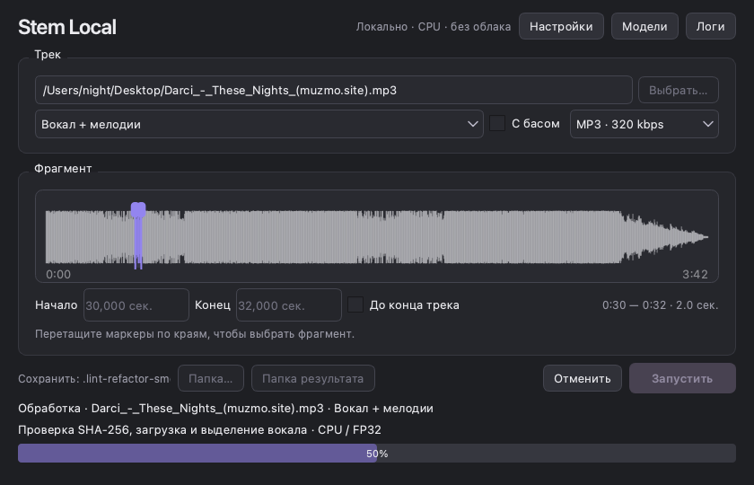

# Stem Local — CPU-прототип

Локальное приложение на Python/PySide6. Инференс **только CPU/FP32**, без облака,
платных API и обязательного GPU. Это рабочая демка из исходников, не готовый установщик.

## Режимы

- **Только вокал** → `vocals.wav` или `vocals.mp3`.
- **Вокал + мелодии** → две отдельные дорожки `vocals` и `melody`.
  Мелодии — группа `other` HTDemucs без вокала/ударных/баса;
   переключатель **«С басом»** добавляет его к мелодической дорожке.
  Это не точная музыкальная классификация: возможны остатки ударных и вокала.

Полный инструментал, общий микс и отдельные ударные не экспортируются.
Экспорт: **WAV PCM 24-bit** или **MP3 CBR 320 кбит/с**. FLAC для выдачи убран.
Внутренний расчёт — float32, общий gain снижает уровень только при необходимости
защиты от перегруза, без нормализации отдельных фрагментов. В MP3 оставлен запас
по пику, но lossy-кодирование всё равно может создавать межсемпловые пики.
Перевод MP3 в WAV не восстанавливает потери исходного кодирования.

## Запуск на macOS и Windows

Поддерживаемые платформы: **macOS 14+ на Apple Silicon** и **Windows x86-64**.
Linux не поддерживается.

Установите самостоятельно Python **3.11**, [uv](https://docs.astral.sh/uv/) и
FFmpeg с **ffprobe** и **libmp3lame** в PATH. Затем в папке проекта выполните:

```sh
uv sync --frozen --python 3.11 --no-python-downloads
```

После установки открывайте **`Start.command`** на Mac или **`Start.cmd`** на Windows.
Скрипты ничего не устанавливают и не скачивают: при отсутствии зависимостей
выводят подсказку. [Подробные требования и инструкция](docs/launch.md).

### Прямой запуск на текущем Mac

Python 3.11 и зависимости уже установлены в `.venv`, веса Kimberley и HTDemucs —
в `models/`. FFmpeg с `libmp3lame` должен быть доступен в PATH.

```sh
cd /Users/night/Desktop/vocal_remover
source .venv/bin/activate
python -m stem_local.gui --cache models
```

1. Выберите аудио и режим.
2. Если весов ещё нет, нажмите **«Подготовить модели»** (нужен интернет).
3. По умолчанию выбран **весь трек: от 0:00 до конца**. Для отрывка перетащите
   два маркера на волне либо снимите «До конца трека» и задайте начало/конец числами.
4. Нажмите **«Запустить»**. Одновременно выполняется только одна задача, очереди нет.
   До её завершения или отмены повторный запуск и изменение настроек недоступны.
   Скачивание моделей также занимает единственное активное задание.
5. После успешного разделения автоматически открывается папка с файлами и
   `report.json` именно этой задачи. Файлы можно открыть обычным аудиоплеером.
   Встроенного плеера и списка/истории готовых результатов в GUI нет.
   При ошибке, отмене или скачивании весов папка автоматически не открывается.

«Настройки» открывают выбор вокальной модели, потоки и перекрытие.
«Логи» в верхней строке открывают отдельное неблокирующее окно с ходом работы
и итоговыми ресурсами. Закрытие окна логов не останавливает обработку.


Интерфейс компактный, графитовый, с фиолетовым акцентом; списка задач и кнопок очереди нет.
Во время работы показаны только текущий файл, этап и его прогресс. Процент разделения
считается по завершённым аудиоокнам; для вокала и мелодий каждая стадия занимает половину
шкалы. Декодирование, загрузка модели и экспорт показывают индикатор ожидания без
выдуманного процента. После успешного завершения — 100%, после отмены/ошибки — 0%.
Волна строится асинхронно FFprobe/FFmpeg: в памяти только фиксированный массив пиков,
не весь исходный аудиофайл. Она служит для выбора диапазона, не для оценки качества.
При недоступности превью числовой выбор работает независимо. Смена входного файла
сбрасывает диапазон на весь трек. Во время работы выбор файла и настроек заблокирован.
После отмены можно сразу запустить новую задачу. На macOS worker пытается убрать временные
файлы; при принудительном завершении/на Windows в папке задачи могут остаться
`.work-*`/`.part`. Они не используются как готовые модели или результаты.

### Таймауты и завершение

- Нет исходника/весов — немодальная ошибка, без ожидания нажатия кнопки в диалоге.
  Файлы повторно проверяются перед запуском и раз в секунду во время задачи.
- Анализ волны: 30 с без данных; затем останавливается только процесс превью,
  числовой выбор диапазона продолжает работать.
- Декодирование и MP3-экспорт: не более 300 с на один внешний вызов FFmpeg.
- GUI-worker: 900 с без событий прогресса/смены этапа. Это не общий лимит длительности
  трека. Для особенно медленного CPU можно увеличить: `--stall-timeout 1800` при запуске GUI.
- При ошибке/таймауте задача останавливается, папка не открывается как успешный результат.
- Закрытие основного окна отменяет текущую задачу; после мягкой остановки
  следует принудительное завершение самого worker, если он не вышел. GUI не обходит
  дерево потомков и не останавливает guardian. Окно логов тоже закрывается.
- Worker и процессы анализа запускаются под отдельным лёгким guardian-процессом,
  не зависящим от PyTorch/GIL. На macOS используются собственные process groups,
  на Windows предусмотрен Job Object с `KILL_ON_JOB_CLOSE`. PID проверяется вместе
  со временем создания, чтобы не завершить другой пользовательский процесс.
  Guardian остаётся активным до выхода worker, в том числе обычного, очищает его
  семью процессов и завершается сам. После принудительного закрытия GUI эта очистка
  может занять ещё несколько секунд.

На текущем Mac тестами проверены таймаут, исчезновение файла, обычное закрытие,
принудительная смерть родительского GUI-процесса и самого worker с дочерним процессом.
Windows Job Object пока **не проверен на Windows**.
При отключении питания очистка кодом невозможна: память/дескрипторы освободит ОС,
а временные файлы могут остаться. При аварийном/принудительном завершении отчёт
задачи также может остаться в состоянии `running`; такой запуск не считается успешным.

## Установка на другом компьютере

Нужны Python 3.11, [uv](https://docs.astral.sh/uv/) и FFmpeg с MP3-энкодером.

```sh
uv sync --frozen --extra dev
source .venv/bin/activate
python -m stem_local.gui
```

На Windows вместо `source` используйте `.venv\Scripts\Activate.ps1` в PowerShell.
Кэш по умолчанию — `~/.cache/stem-local/models`, либо задайте `--cache models`.
`uv` настроен на CPU-колёса PyTorch для Windows; на macOS устройство CPU
принудительно задаётся в коде **до** загрузки моделей. Установленная версия PyTorch
на Apple Silicon требует macOS 14+. Системный Python не изменяется.

**Реально проверено:** macOS 27.2 arm64, Apple M5, 24 GiB RAM, Python 3.11.15.
**Не проверено:** Windows x86-64, M1, компьютер с i5-12600K и система с 16 GiB RAM.
Сборки со встроенным Python пока не сделаны. Кроссплатформенность исходников
не равна проверке бинарных сборок на этих системах.

## CLI

```sh
source .venv/bin/activate
python -m stem_local.worker download --model kimberley --mode vocals-melody --cache models
python -m stem_local.worker separate "track.mp3" --cache models --start 30 --duration 45 --format MP3
python -m stem_local.worker separate "track.mp3" --cache models --mode vocals-melody --format WAV --full
```

`--keep-bass` сохраняет бас в мелодиях. `--threads 4` задаёт потоки,
`--overlap 2|4|8` — число перекрытий RoFormer (выше обычно медленнее, не гарантия качества).
Для i5-12600K сравните **последовательно** `--threads 4`, `6`, `10`, `16` на одном
фрагменте, с одинаковыми остальными параметрами. Не переносите цифры M5 на этот CPU.
Без `--duration` CLI тоже обрабатывает трек до конца; `--duration` задаёт длину
отрывка от `--start`. В GUI вместо длительности задаются абсолютные начало и конец.

ViperX присутствует как альтернативный адаптер, но не скачан/не сравнивался:
лицензия его конкретных весов не подтверждена. Для эксперимента требуется явный
`--accept-unverified-license`; это не разрешение на перераспространение.

## Измеренные прогоны

Darci — These Nights, участок 0:30–1:15, 45 секунд, M5/24 GiB, 4 потока, overlap=2:

| Режим | Полное время worker | Пик RSS дерева процессов, sampled |
| --- | ---: | ---: |
| Первоначальный вокал + инструментал, FLAC (старый режим) | 39,10 с | 2,88 GiB |
| Вокал + мелодии без баса, MP3 320 | 50,85 с | 2,89 GiB |

Время включает импорты, декодирование, проверку/загрузку весов, инференс и экспорт,
но **не скачивание**. Память — RSS worker и его дочерних процессов с шагом 100 мс;
GUI, память системы и своп не включены. В отчётах также есть OS high-water RSS
самого worker. RAM 16 GiB — ориентир, не измеренный здесь лимит.

В обоих реальных прогонах проверены устройства параметров/буферов и входов модели.
Во втором подтверждены 10 forward-вызовов RoFormer и 10 Demucs на CPU/FP32.
Качество вокала первого прогона пользователь оценил как «нормально, неплохо»;
субъективная оценка мелодий и сравнение с ViperX пока не проведены.

## Проверки и сопровождение

```sh
source .venv/bin/activate
make test
make lint
```

Тесты проверяют стыки/длину, обрезку аудио, WAV и настоящий MP3 320, отсутствие
лишних стемов, выбор баса, CPU-защиту, запрет сети, контрольные суммы, GUI и отмену.
Unit-тесты не скачивают и не запускают большие веса; реальные прогоны описаны выше.

[Как обновлять модели и что с долгосрочной поддержкой](docs/model-updates.md)

[Архитектура и подключение других фреймворков](docs/architecture.md)

[Эксперимент CPU/MPS и отложенный проект автовыбора](docs/auto-device-design.md).
В приложении по-прежнему только CPU: эксперимент не включает MPS автоматически.

`make lint` запускает полный `ruff check .`, проверку форматирования и `mypy src tests`.
Правила берутся из актуального `pyproject.toml`, без переопределения `--select` в команде.
`make lint-fix` применяет автоматические исправления Ruff и форматирование; после него
нужно повторить `make lint` и `make test`.

Точечные `noqa` снабжены причинами: имена виртуальных методов Qt, позиционный bool
Qt-сигнала, русская подпись, проверенные argv/HTTPS и намеренные отложенные импорты.
Общий перехват исключений оставлен только на CLI-границе, где ошибка передаётся GUI
и worker завершается ненулевым кодом.
Импорты аудиопайплайна и PyTorch остаются отложенными, чтобы GUI не загружал модели,
а отсутствующий входной файл обнаруживался до загрузки тяжёлого runtime.

## Лицензии и распространение

Собственный код демки — MIT, см. `LICENSE`. Это **не** общая лицензия всех зависимостей.
`audio-separator` — MIT; Kimberley — MIT по карточке модели; Demucs — MIT по авторскому
репозиторию. Все конкретные URL и SHA-256 записываются в отчёт.
PySide6/Qt имеют LGPL/GPL/commercial варианты лицензирования; PyTorch — BSD-style;
FFmpeg зависит от состава сборки. Текущий Homebrew FFmpeg собран с GPL/version3.
Перед распространением установщиков нужен отдельный аудит Qt, FFmpeg, libsndfile,
транзитивных зависимостей, уведомлений/исходников и лицензий весов. Веса в бинарную
сборку сейчас не включаются. Права на обрабатываемые записи — ответственность пользователя.
